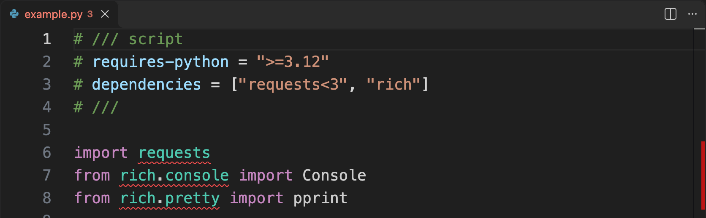

# Checking standalone scripts

When your script imports third-party packages, ty looks for them in a Python environment to
check your code. You can declare the script's dependencies and Python version requirements
using [inline script metadata (PEP 723)](https://peps.python.org/pep-0723/).

[uv](https://docs.astral.sh/uv/) uses this metadata to prepare an environment when you
[run a script](https://docs.astral.sh/uv/guides/scripts/). ty reads the same metadata to find
scripts in your project. When you enable the uv integration, ty asks uv to install each script's
dependencies in its own environment. This lets you check the project and its scripts together,
even when they target different Python versions or use different versions of the same package.

!!! note "Preview"

    The uv integration for scripts is in preview and off by default. The minimum supported versions
    are uv 0.12.3 and ty 0.0.76.

## On the command line

For example, the following script requires `requests` and `rich`.

```python title="example.py"
# /// script
# requires-python = ">=3.12"
# dependencies = ["requests<3", "rich"]
# ///

import requests
from rich.console import Console
from rich.pretty import pprint

response = requests.get("https://peps.python.org/api/peps.json")
peps = response.json()
Console().rule("Python Enhancement Proposals")
pprint([(number, pep["title"]) for number, pep in peps.items()][:10])
```

If these packages are missing from your Python environment, `ty check` reports unresolved imports.

```console
$ ty check example.py
error[unresolved-import]: Cannot resolve imported module `requests`
 --> example.py:6:8
  |
6 | import requests
  |        ^^^^^^^^
...

error[unresolved-import]: Cannot resolve imported module `rich.console`
 --> example.py:7:6
  |
7 | from rich.console import Console
  |      ^^^^^^^^^^^^
...

error[unresolved-import]: Cannot resolve imported module `rich.pretty`
 --> example.py:8:6
  |
8 | from rich.pretty import pprint
  |      ^^^^^^^^^^^
...

Found 3 diagnostics
```

Run the check again with [`TY_UV=scripts`](https://docs.astral.sh/ty/reference/environment/#ty_uv)
to enable the uv integration. ty asks uv to install the script's dependencies.

```console
$ TY_UV=scripts ty check example.py
All checks passed!
```

You can also check the script with uv's experimental
[`uv check --script example.py`](https://docs.astral.sh/uv/reference/cli/#uv-check--script) command,
which enables the integration automatically.

To check the project and its scripts together, run `ty check` without a file name.

```shell
TY_UV=scripts ty check
```

If a script declares an [alternative package index](https://docs.astral.sh/uv/guides/scripts/#using-alternative-package-indexes),
uv uses it to resolve the script's dependencies.

## In your editor

With the uv integration off, ty looks for the script's dependencies in your Python environment.
If `rich` is missing, you'll see the same unresolved import for `rich.pretty` in your editor as
on the command line. ty needs the package to offer completions for `rich.pretty`, show `pprint`'s
signature on hover, or jump to its definition.



Set [`experimental.useUv`](./reference/editor-settings.md#experimentaluseuv) to `"scripts"` to
enable the integration in your editor. ty asks uv to install the script's declared dependencies
and uses the script's environment for its [language server features](./features/language-server.md).

<figure>
  <video src="../assets/scripts-editor-demo.mp4" controls playsinline preload="metadata"
         width="1440" height="900" style="max-width: 100%; height: auto;"
         aria-labelledby="script-editor-demo-caption">
    <a href="../assets/scripts-editor-demo.mp4">Download the editor demo</a>.
  </video>
  <figcaption id="script-editor-demo-caption">
    With the integration on, ty uses uv to install <code>rich</code> after it's added to the
    dependency list and the script is saved. Selecting the <code>Console</code> completion adds
    the import. Editor features such as completions, hover, and Go to Definition now work
    with <code>rich</code>.
  </figcaption>
</figure>

## Configuring a script

A script in a project uses the [project's ty settings](./configuration.md) by default. For
example, if your project disables [`index-out-of-bounds`](./reference/rules.md#index-out-of-bounds),
ty skips that rule in `scripts/example.py`. An [`override`](./reference/configuration.md#overrides)
for `scripts/*.py` can turn the rule back on for that file.

ty also respects the script's Python version requirements. Changing `requires-python` to
`">=3.13"` makes ty check `scripts/example.py` against Python 3.13, even if the project targets
Python 3.12.

To share `scripts/example.py` with its own ty configuration, you can add a
[`[tool.ty]`](./reference/configuration.md) table to its inline metadata. The table uses the
same syntax as in `pyproject.toml`.

```python title="scripts/example.py"
# /// script
# requires-python = ">=3.12"
# dependencies = ["requests<3", "rich"]
#
# [tool.ty.rules]
# index-out-of-bounds = "warn"
# ///
```

The inline table replaces the project settings and overrides for the script, even if it is empty.
With this configuration, ty treats `index-out-of-bounds` as a warning and uses its defaults for
other settings.
